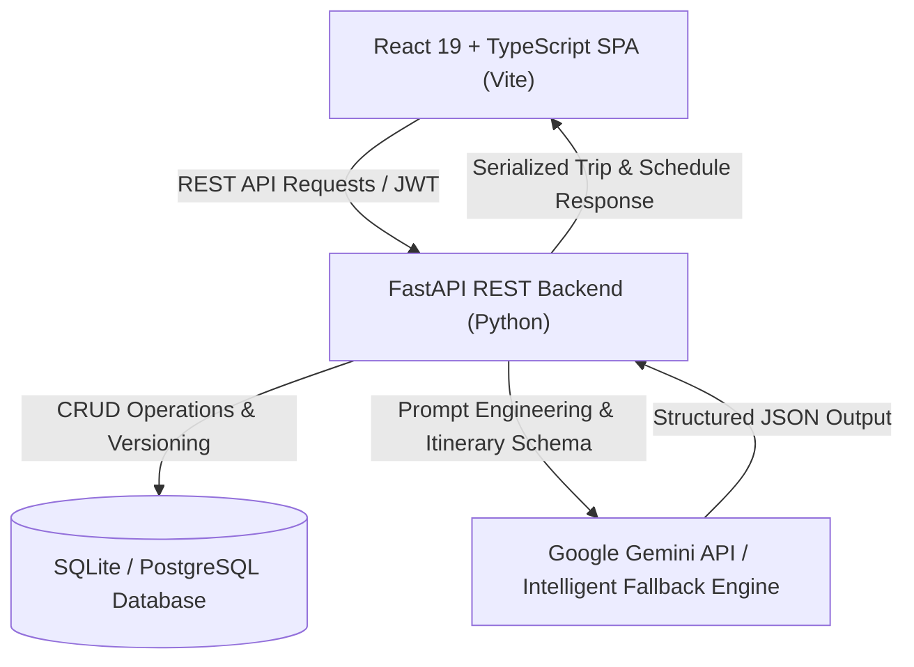

# 🧭 TripNest — AI-Powered Personalized Travel Planner

[](https://fastapi.tiangolo.com)
[](https://react.dev)
[](https://www.typescriptlang.org)
[](https://tailwindcss.com)
[](https://vite.dev)
[](https://www.python.org)
[](https://opensource.org/licenses/MIT)

**TripNest** is a production-ready, full-stack AI travel planning platform. It leverages generative AI (Google Gemini) and intelligent fallback algorithms to generate, edit, recalculate, and export day-by-day travel itineraries customized by traveler preferences, budget limits (INR), travel styles, group sizes, and pacing.

---

## ✨ Key Features

### 🤖 Intelligent AI Itinerary Generation
- **Dynamic Multi-Tier Budget Engine**: Automatically categorizes trips into **Backpacker** (< ₹20k), **Comfort** (₹20k–₹55k), **Luxury** (₹55k–₹1.1L), and **Royal VIP** (> ₹1.1L).
- **Realistic Cost Allocation**: Calculates day-by-day burn rates and categorizes expenses across Accommodation, Food & Dining, Transportation, Activities, and Miscellaneous.
- **Google Gemini Integration**: Dynamic prompt orchestration with live API key configuration directly in the Settings page.
- **Deterministic Offline Fallback Planner**: Generates verified landmarks, realistic travel times, geo-coordinates, and authentic regional dining options without requiring third-party API keys.

### 🎯 Granular Itinerary Customization & Recalibration
- **Interactive Budget Recalibration Modal**: Change your budget on the fly with quick tier chips (`₹12k`, `₹35k`, `₹85k`, `₹1.5L`) and regenerate the itinerary in seconds.
- **Lock & Preserve Stops**: Lock favorite activities so they remain untouched during single-day regeneration.
- **Activity Swapping**: Swap any scheduled stop with curated AI alternatives matching your pace and interests.
- **Interactive Activity Editing**: Modify start times, estimated costs, transport types, and durations.

### 💼 Comprehensive Travel SaaS Suite
- **Interactive Day-by-Day Timeline**: Morning, afternoon, and evening breakdowns with transit times and activity tips.
- **Budget Breakdown Charts**: Interactive donut visualizations powered by **Recharts**.
- **Print & PDF Export**: Clean, print-optimized stylesheet for offline travel binders.
- **Trip Bookmarking & Duplication**: Save itineraries to your favorites or clone existing trips for future variations.
- **1-Click Demo Traveler Login**: Test immediately as demo user **Alex Turner** (`traveler@tripnest.com`) with pre-seeded trips.

---

## 🏗️ Architecture



---

## 📂 Project Structure

```
tripnest/
├── backend/
│   ├── app/
│   │   ├── api/             # REST Endpoints (auth, trips, ai, saved, destinations, settings)
│   │   ├── core/            # Security, JWT auth, config settings
│   │   ├── database/        # SQLAlchemy engine, session & declarative base
│   │   ├── models/          # ORM models (User, Trip, Itinerary, SavedItinerary)
│   │   ├── schemas/         # Pydantic v2 validation models
│   │   ├── services/        # AI orchestration & trip planning services
│   │   ├── utils/           # Deterministic multi-tier fallback planner
│   │   └── main.py          # FastAPI application entrypoint & database seeding
│   ├── requirements.txt     # Python backend dependencies
│   └── .env.example         # Environment template for backend
├── frontend/
│   ├── src/
│   │   ├── components/
│   │   │   ├── common/      # Toast notifications, modals
│   │   │   ├── dashboard/   # Hero, QuickBuilder, PopularDestinations, RecentTrips
│   │   │   ├── itinerary/   # Timeline, BudgetModal, SummaryCards, BudgetChart
│   │   │   └── layout/      # Navy Sidebar, TopNavbar, MainLayout
│   │   ├── pages/           # Dashboard, CreateTrip, MyTrips, TripDetail, Edit, Profile, Settings, Auth
│   │   ├── services/        # Axios API client
│   │   ├── store/           # Zustand state management (Trip, UI, Auth)
│   │   └── types/           # TypeScript interfaces matching API schemas
│   ├── package.json
│   ├── vite.config.ts       # Reverse proxy configuration to FastAPI
│   └── tsconfig.json
├── supabase/
│   └── schema.sql           # PostgreSQL schema with Row-Level Security (RLS)
└── README.md
```

---

## 🚀 Getting Started

### Prerequisites
- **Node.js** (v18 or higher)
- **Python** (v3.11 or higher)
- **Git**

---

### 1. Clone the Repository

```bash
git clone https://github.com/your-username/tripnest.git
cd tripnest
```

---

### 2. Backend Setup (FastAPI)

1. Navigate to the `backend` folder:
   ```bash
   cd backend
   ```

2. Create and activate a virtual environment (optional but recommended):
   ```bash
   # Windows
   python -m venv venv
   venv\Scripts\activate

   # macOS / Linux
   python3 -m venv venv
   source venv/bin/activate
   ```

3. Install dependencies:
   ```bash
   pip install -r requirements.txt
   ```

4. Configure environment variables:
   ```bash
   # Copy example environment file
   cp .env.example .env
   ```
   *(By default, it uses a zero-configuration local SQLite database `tripnest.db`)*

5. Start the backend development server:
   ```bash
   python -m uvicorn app.main:app --reload --host 127.0.0.1 --port 8000
   ```

- **API Documentation (Swagger UI)**: [http://127.0.0.1:8000/docs](http://127.0.0.1:8000/docs)
- **Health Check**: [http://127.0.0.1:8000/api/health](http://127.0.0.1:8000/api/health)

---

### 3. Frontend Setup (React + Vite)

1. Open a new terminal and navigate to `frontend`:
   ```bash
   cd frontend
   ```

2. Install dependencies:
   ```bash
   npm install
   ```

3. Start the Vite development server:
   ```bash
   npm run dev
   ```

4. Open your browser and visit:
   ```
   http://localhost:5173
   ```

---

## 🔑 Demo Account Credentials

TripNest comes pre-configured with a 1-click demo login:

- **Email**: `traveler@tripnest.com`
- **Password**: `DemoPass123!`
- *Or simply click **"Try Demo Account"** on the Login page.*

---

## ⚙️ Environment Variables

### Backend (`backend/.env`)

| Variable | Default Value | Description |
| :--- | :--- | :--- |
| `PROJECT_NAME` | `TripNest API` | Application title |
| `SECRET_KEY` | `your-secret-key-change-in-production` | Secret key for JWT tokens |
| `DATABASE_URL` | `sqlite:///./tripnest.db` | Database connection URL |
| `AI_API_KEY` | `""` | Optional Google Gemini API key |
| `AI_MODEL` | `gemini-1.5-flash` | Gemini model identifier |

---

## 📱 Mobile & Remote Network Access

TripNest's Vite dev server is pre-configured to bind to `0.0.0.0`, allowing you to access it directly from your smartphone or tablet on the same Wi-Fi network:

```
http://<YOUR_COMPUTER_LOCAL_IP>:5173
```

---

## 🛠️ API Endpoints Overview

| Method | Endpoint | Description |
| :--- | :--- | :--- |
| `POST` | `/api/auth/login` | Authenticate user and receive JWT bearer token |
| `POST` | `/api/auth/demo` | Instant 1-click demo authentication |
| `GET` | `/api/trips` | Fetch all trips for current user with filters |
| `POST` | `/api/trips` | Create trip and generate complete AI itinerary |
| `GET` | `/api/trips/{id}` | Get complete trip details and active itinerary |
| `PUT` | `/api/trips/{id}` | Update trip parameters and auto-recalibrate budget |
| `DELETE` | `/api/trips/{id}` | Delete a trip |
| `POST` | `/api/ai/regenerate-itinerary/{id}` | Regenerate trip with new budget or preferences |
| `POST` | `/api/ai/regenerate-day` | Re-generate specific day while preserving locked stops |
| `POST` | `/api/ai/replace-activity` | Replace individual activity with alternative |

---

## 📄 License

This project is licensed under the MIT License — see the [LICENSE](LICENSE) file for details.
